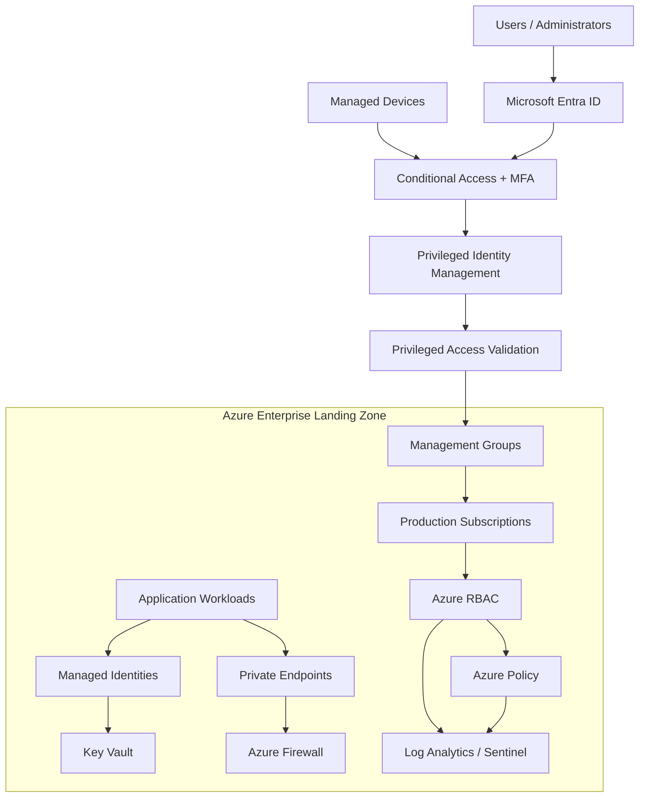

# 🔐 Zero Trust Security Architecture – Production Azure Landing Zone


## 📌 Overview

This repository documents an enterprise-grade **Zero Trust Access Model** for production Azure Landing Zones.

The architecture follows Microsoft's Zero Trust security principles:

- Never Trust, Always Verify.
- Apply Least Privilege Access.
- Assume Breach.
- Verify Explicitly.
- Continuously Monitor and Evaluate Access.

The objective is to ensure that every user, workload, device, API, and service accessing Azure resources is authenticated, authorized, monitored, and continuously evaluated.

## 🏗️ Zero Trust Architecture



## 🎯 1. Core Zero Trust Security Principles

| Principle | Enterprise Implementation |
|---|---|
| Verify Explicitly | Entra ID authentication and MFA |
| Least Privilege | Azure RBAC and scoped permissions |
| Assume Breach | Network segmentation and monitoring |
| Identity First | Entra ID and Managed Identities |
| Continuous Validation | Conditional Access and risk policies |
| Data Protection | Key Vault and encryption |
| Governance | Azure Policy and Management Groups |

## 🔑 2. Identity and Access Management

**Primary Service: Microsoft Entra ID**

Implement centralized identity governance across all Azure subscriptions.

Security controls:

- Enforce MFA for all privileged accounts.
- Implement Conditional Access policies.
- Block legacy authentication protocols.
- Enable risk-based sign-in policies where licensed.
- Use Privileged Identity Management (PIM).
- Enforce Just-In-Time (JIT) administrative access.
- Separate standard and privileged administrator accounts.
- Implement emergency break-glass accounts with monitoring.
- Use Access Reviews for privileged roles.
- Integrate workload identities with federated credentials.

### Recommended Administrative Roles

| Role | Access Strategy |
|---|---|
| Global Administrator | PIM eligible |
| Privileged Role Administrator | PIM eligible |
| Owner | Restricted and time-bound |
| Contributor | Scoped resource access |
| Security Administrator | PIM eligible |
| Reader | Least privilege |
| Network Contributor | Network scope only |

**Best Practice:** Avoid permanent Owner and Contributor assignments at subscription or management group scope.

## 🛡️ 3. Azure RBAC Security Model

Implement role-based access control at the lowest practical scope.

Recommended hierarchy:

```text
Tenant Root Management Group
        |
        └── Organization Management Group
                |
                ├── Platform Management Group
                |       ├── Identity Subscription
                |       ├── Connectivity Subscription
                |       └── Management Subscription
                |
                ├── Landing Zones
                |       ├── Production Subscription
                |       ├── Non-Production Subscription
                |       └── Sandbox Subscription
                |
                └── Decommissioned
```

RBAC implementation standards:

- Assign roles through Entra ID security groups.
- Avoid direct user-level RBAC assignments.
- Apply subscription-level permissions only when required.
- Use resource group-level permissions for application teams.
- Implement custom roles only when built-in roles are insufficient.
- Review role assignments periodically.
- Use deny assignments and Azure Policy protections where appropriate.

## 🌐 4. Network Zero Trust Architecture

**Primary Services:**

- Azure Firewall Premium
- Azure Virtual Network
- Network Security Groups (NSGs)
- Azure Private Link
- Private DNS Zones
- Azure Bastion
- DDoS Network Protection
- Web Application Firewall (WAF)

Security implementation:

- Implement hub-and-spoke network topology.
- Deny unnecessary inbound and outbound traffic.
- Use private endpoints for supported PaaS services.
- Disable public network access wherever feasible.
- Route outbound traffic through Azure Firewall.
- Enable network segmentation between workloads.
- Restrict administrative access through secure management paths.
- Use Azure Bastion instead of exposing VM management ports.
- Apply WAF protection to internet-facing applications.
- Enable DDoS protection for critical public workloads.

## 🔐 5. Workload Identity and Secret Management

**Primary Services:**

- Azure Managed Identities
- Azure Key Vault
- Microsoft Entra Workload ID
- Federated Identity Credentials

Implementation standards:

- Prefer Managed Identities over service principal secrets.
- Eliminate hardcoded credentials in Terraform.
- Store application secrets in Azure Key Vault.
- Enable Key Vault RBAC authorization.
- Restrict Key Vault access through private endpoints.
- Enable soft delete and purge protection.
- Rotate credentials and certificates where applicable.
- Use workload identity federation for CI/CD pipelines.

## 📊 6. Monitoring and Security Operations

**Primary Services:**

- Microsoft Defender for Cloud
- Microsoft Sentinel
- Azure Monitor
- Log Analytics Workspace
- Microsoft Entra ID Logs
- Azure Activity Logs

Security monitoring:

- Monitor privileged role assignments.
- Detect unusual authentication activities.
- Monitor Conditional Access failures.
- Alert on Key Vault access anomalies.
- Detect unexpected network exposure.
- Monitor public IP and firewall changes.
- Enable Defender for Cloud recommendations.
- Centralize security logs.
- Configure incident response playbooks.

## 🏛️ 7. Governance and Compliance

Use Azure Policy and Management Groups to enforce enterprise-wide security standards.

| Governance Area | Recommended Control |
|---|---|
| Identity | MFA and Conditional Access |
| RBAC | Least privilege |
| Networking | Restrict public endpoints |
| Storage | Secure transfer and encryption |
| Key Vault | RBAC and purge protection |
| Compute | Defender for Cloud |
| Logging | Centralized diagnostics |
| Resources | Mandatory tagging |
| Compliance | Azure Policy initiatives |

Recommended policy initiatives:

- Microsoft Cloud Security Benchmark.
- Microsoft Defender for Cloud regulatory compliance initiatives.
- Organization-specific security baselines.

## ⚙️ 8. Terraform Implementation Structure

```text
azure-zero-trust-landing-zone/
│
├── bootstrap/
│   ├── main.tf
│   ├── backend.tf
│   └── providers.tf
│
├── modules/
│   ├── identity/
│   │   ├── main.tf
│   │   ├── variables.tf
│   │   └── outputs.tf
│   │
│   ├── rbac/
│   │   ├── main.tf
│   │   ├── assignments.tf
│   │   └── variables.tf
│   │
│   ├── management-groups/
│   ├── policy/
│   ├── networking/
│   ├── firewall/
│   ├── private-endpoints/
│   ├── key-vault/
│   ├── managed-identities/
│   ├── monitoring/
│   └── defender/
│
├── environments/
│   ├── production/
│   │   ├── main.tf
│   │   ├── terraform.tfvars
│   │   └── backend.hcl
│   │
│   └── non-production/
│       ├── main.tf
│       └── terraform.tfvars
│
├── policies/
│   ├── allowed-locations/
│   ├── public-access-restrictions/
│   └── mandatory-tags/
│
├── pipelines/
│   ├── terraform-plan.yml
│   └── terraform-apply.yml
│
└── README.md
```

## 🚀 9. Secure CI/CD Implementation

Recommended deployment workflow:

1. Developer creates a Terraform pull request.
2. GitHub Actions validates Terraform formatting.
3. Run Terraform validation and security scanning.
4. Execute Checkov or equivalent IaC security checks.
5. Generate Terraform plan.
6. Require authorized reviewers and security approval.
7. Authenticate using GitHub OIDC federation with Microsoft Entra ID.
8. Apply Terraform using a restricted deployment identity.
9. Validate deployed resources against Azure Policy.
10. Send deployment and security events to centralized monitoring.

**Important:** Separate plan and apply permissions, protect production environments, and never store long-lived Azure client secrets in GitHub.

## ✅ 10. Production Security Checklist

- [ ] Enforce MFA for privileged identities.
- [ ] Enable Conditional Access policies.
- [ ] Enable PIM for administrative roles.
- [ ] Implement least-privilege Azure RBAC.
- [ ] Configure emergency access accounts.
- [ ] Disable legacy authentication.
- [ ] Implement hub-and-spoke network segmentation.
- [ ] Restrict public PaaS access.
- [ ] Enable Private Endpoints where applicable.
- [ ] Enable Azure Firewall and NSGs.
- [ ] Use Managed Identities for workloads.
- [ ] Enable Key Vault soft delete and purge protection.
- [ ] Configure Defender for Cloud.
- [ ] Enable centralized Log Analytics.
- [ ] Integrate Microsoft Sentinel.
- [ ] Enforce Azure Policy initiatives.
- [ ] Enable Terraform state protection.
- [ ] Use GitHub OIDC authentication.
- [ ] Perform periodic access reviews.
- [ ] Test incident response and recovery procedures.

## 🏆 Expected Security Outcomes

| Security Domain | Expected Outcome |
|---|---|
| Identity | Strong authentication |
| Privileged Access | Controlled elevation |
| RBAC | Least privilege |
| Network | Reduced attack surface |
| Workloads | Secretless authentication |
| Data | Encryption and access protection |
| Governance | Policy-driven compliance |
| Monitoring | Centralized threat detection |
| Automation | Secure IaC deployment |

## 📚 Microsoft Documentation

- [Microsoft Zero Trust Guidance](https://learn.microsoft.com/en-us/security/zero-trust/)
- [Azure Landing Zones](https://learn.microsoft.com/en-us/azure/cloud-adoption-framework/ready/landing-zone/)
- [Azure RBAC](https://learn.microsoft.com/en-us/azure/role-based-access-control/overview)
- [Microsoft Entra Conditional Access](https://learn.microsoft.com/en-us/entra/identity/conditional-access/overview)
- [Privileged Identity Management](https://learn.microsoft.com/en-us/entra/id-governance/privileged-identity-management/pim-configure)
- [Azure Policy](https://learn.microsoft.com/en-us/azure/governance/policy/overview)
- [Azure Private Link](https://learn.microsoft.com/en-us/azure/private-link/private-link-overview)
- [Terraform Azure Provider](https://registry.terraform.io/providers/hashicorp/azurerm/latest/docs)

---

**Architecture Philosophy:** Identity is the new perimeter. Every access request must be authenticated, authorized, and continuously evaluated. No user, device, application, or workload should receive implicit trust simply because it operates inside the Azure network.

**Built for:** Enterprise Azure Cloud | Platform Engineering | Cloud Security | DevSecOps | Infrastructure as Code
